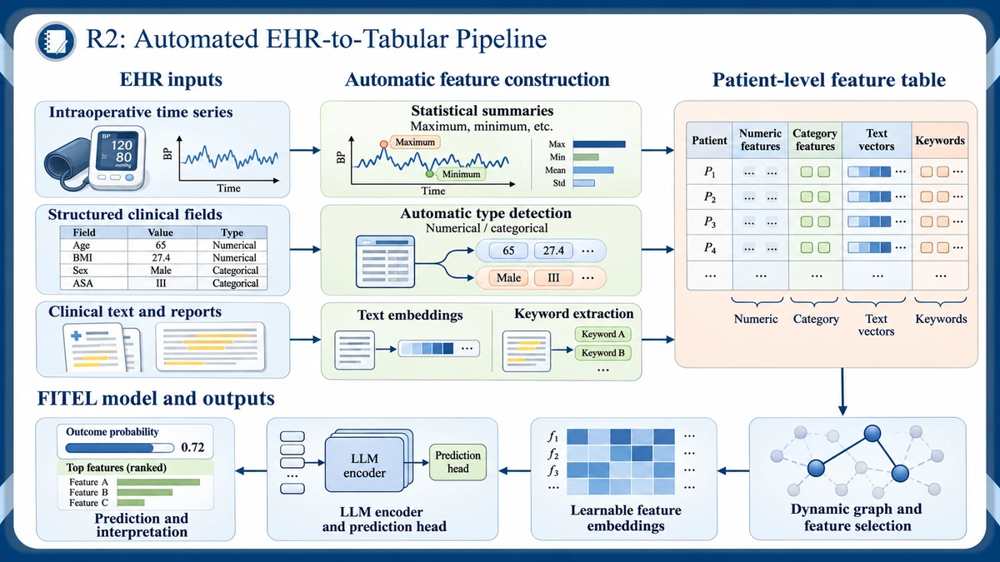

# EHR-AutoPipeline

### From heterogeneous EHR data to a patient-level feature table

A workflow for constructing tabular features from **intraoperative time series, structured clinical fields, and clinical text or reports**. The resulting table combines numerical features, categorical features, text embeddings and extracted keywords for downstream prediction.

## Framework

*Framework illustration from the EHR project. Example patient rows, values and model outputs are schematic.*

## Processing workflow

| Input | Processing | Output features |
| --- | --- | --- |
| Intraoperative time series, such as blood pressure | Compute statistical summaries, including maximum, minimum, mean and standard deviation. | Numerical summary features |
| Structured clinical fields, such as age, BMI, sex and ASA class | Automatically distinguish numerical and categorical fields. | Numerical and categorical features |
| Clinical text and reports | Produce text embeddings and extract report keywords. | Text vectors and keyword features |

The feature groups are aligned into a **patient-level feature table**. Each row represents a patient, with the constructed features in separate columns.

## Downstream prediction

The framework connects the feature table to **FITEL**: dynamic graph construction and feature selection, learnable feature embeddings, and an LLM encoder with a prediction head. The final outputs are an outcome probability and ranked informative features.

See [FITEL](https://github.com/shuting-pang/FITEL) for the released tabular prediction model code.

## Repository status

This repository currently provides the framework and workflow description. The EHR preprocessing code release is in preparation.
